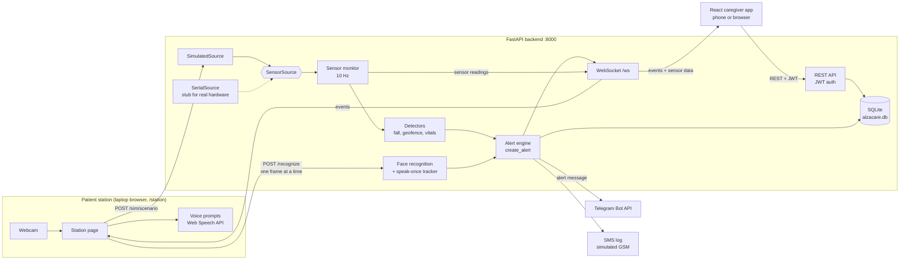

# AlzaCare Web

AlzaCare is a caregiver monitoring prototype for a person living with Alzheimer's disease.
A **patient station** (a laptop standing in for a wearable device) recognizes visitors with its
webcam and tells the patient who they are, speaks safety prompts and medication reminders, and
streams wearable sensor data. A **FastAPI backend** runs face recognition, fall detection, a
geofence and vitals rules, and sends alerts. A mobile-first **React caregiver app** shows the
patient's live status, a map, alert history, and lets the caregiver manage known people,
reminders and the patient profile. It can be installed on a phone home screen.

The wearable's sensors are simulated, but every detection and alerting step that runs on them is
real code (see [What is real vs what is simulated](#what-is-real-vs-what-is-simulated)).

## Architecture



**Flow of an alert:** a detector (or the face recognizer) raises a detection, then `create_alert()`
1. saves an Event in SQLite,
2. broadcasts it over the WebSocket to every open app,
3. sends a Telegram message, prefixed `[SIMULATED SENSOR]` when the data came from the simulator,
4. logs a simulated GSM SMS as a second event.

## What is real vs what is simulated

| Part | Status | Notes |
|---|---|---|
| Face recognition (dlib / `face_recognition`) | **REAL** | Webcam frames, 128-d encodings, tolerance 0.45 |
| Speak-once logic | **REAL** | 3 stable frames, 60 s cooldown, 10 s absence reset |
| Fall detection algorithm | **REAL** | > 2.5 g impact, then ~2 s of stillness near 1 g |
| Geofence calculation | **REAL** | Haversine distance, hysteresis, re-alert every 2 min |
| Vitals rules | **REAL** | Heart rate > 120 or < 45, SpO2 < 92, battery < 15 %, 2 min cooldown |
| Alert engine | **REAL** | Store, WebSocket broadcast, Telegram, SMS log |
| Telegram delivery | **REAL** | Telegram Bot API over HTTPS |
| Authentication | **REAL** | JWT, bcrypt password hashing |
| Database | **REAL** | SQLite through SQLAlchemy |
| Voice prompts | **REAL** | Browser speech synthesis on the patient station |
| IMU (accelerometer) data | SIMULATED | `SimulatedSource`: walking, sitting and fall patterns |
| GPS data | SIMULATED | Smooth path starting from the patient's home |
| Vitals sensor data | SIMULATED | Heart rate, SpO2 and battery |
| GSM module | SIMULATED | Replaced by Telegram; each alert is also logged as a "SIMULATED GSM SMS" event |
| Wearable device | SIMULATED | The laptop patient station stands in for it |

Simulated data is always labelled: events carry `source: "simulated"`, the app shows a
**SIMULATED** badge, and Telegram messages start with `[SIMULATED SENSOR]`.

## Moving to real hardware

The detectors only see `SensorReading` objects from a `SensorSource`
(`backend/app/sensors/base.py`) and never know where the data came from. To use a real
wearable, implement `SerialSource.read()` in `backend/app/sensors/serial_source.py` (read the
serial port in a background thread and return the latest parsed reading), then swap one line in
`backend/app/services/sensor_monitor.py`:

```python
monitor = SensorMonitor(SerialSource("COM3"))  # was SensorMonitor(SimulatedSource())
```

No other code changes. Fall detection, geofence, vitals rules, alerts, the WebSocket and the app
all work the same way, and alerts are automatically labelled `real` instead of `simulated`.

## Setup

### Requirements

- Python environment `yolo-env1` (Anaconda) with `face_recognition`, `dlib`, `numpy` and `Pillow`
  already installed
- Node.js 20+ and npm

### Backend

```
cd backend
copy .env.example .env
C:\Users\vaibu\anaconda3\envs\yolo-env1\python.exe -m pip install -r requirements.txt
C:\Users\vaibu\anaconda3\envs\yolo-env1\python.exe -m uvicorn app.main:app --host 0.0.0.0 --port 8000 --reload
```

In `backend/.env`, set `JWT_SECRET` to a long random string. Optionally set `TELEGRAM_BOT_TOKEN`
and `TELEGRAM_CHAT_ID`; without them, Telegram is skipped with a log line.

On first start the backend creates `alzacare.db` with the caregiver login **caregiver / alza123**
and a demo patient (Chennai, 200 m safe radius).
Health check: http://localhost:8000/health. API docs: http://localhost:8000/docs

### Frontend

With the backend running:

```
cd frontend
npm install
npm run dev
```

Open http://localhost:5173 and sign in. From a phone on the same Wi-Fi, use the "Network" address
Vite prints (for example http://192.168.0.2:5173); the app calls the backend on port 8000 of the
same host. The camera and geolocation need `localhost` or https, so run the
patient station on the laptop itself.

To install the app on a phone, open it in the browser and choose **Add to Home Screen**.

### Tests

```
cd backend
C:\Users\vaibu\anaconda3\envs\yolo-env1\python.exe tests/test_sensors.py       # detectors vs simulator, no server needed
C:\Users\vaibu\anaconda3\envs\yolo-env1\python.exe tests/test_recognition.py   # speak-once rules, needs the server and one enrolled person
```

## Demo walkthrough

1. **People:** add a family member with a photo (upload or webcam).
2. **More → Patient station** (on the laptop): click **Start camera**. When that person sits in
   front of the camera, the station says "This is your <relationship>, <name>" once.
3. On the station, press **Fall** or **Wander** in the *SIMULATED SENSORS* panel. The caregiver app
   (for example on a phone) shows a red banner, the Map shows the patient leaving the safe zone,
   the station speaks a safety prompt, and Telegram receives the alert.
4. **More → Reminders:** add a reminder for the next minute; the station reads it aloud.

## Project structure

```
backend/
  app/
    main.py            FastAPI app, startup (DB, face cache, sensor loop)
    config.py          all settings and thresholds
    models.py          SQLAlchemy tables
    schemas.py         request/response models
    auth.py            JWT + password hashing
    routers/           auth, patient, known-persons, recognize, events, reminders,
                       alerts, sim, status, uploads, ws
    services/          alerts, telegram, recognition, faces, detectors, sensor_monitor, ...
    sensors/           SensorSource base, SimulatedSource, SerialSource stub
  tests/               test_sensors.py, test_recognition.py
frontend/
  src/
    api.js             every backend call + WebSocket URL
    context/           AuthContext, LiveDataContext (REST + WebSocket)
    hooks/             camera, recognition loop, voice prompts, reminders, ...
    pages/             Login, Home, Alerts, Map, People, More, Station
    components/        UI building blocks
  public/              manifest.webmanifest, app icons
```
